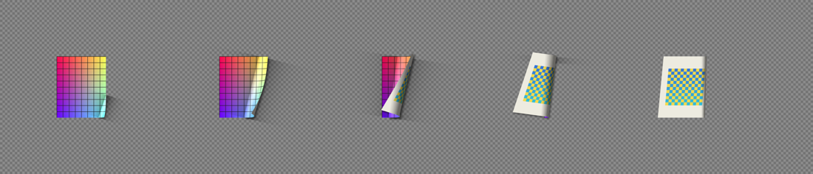
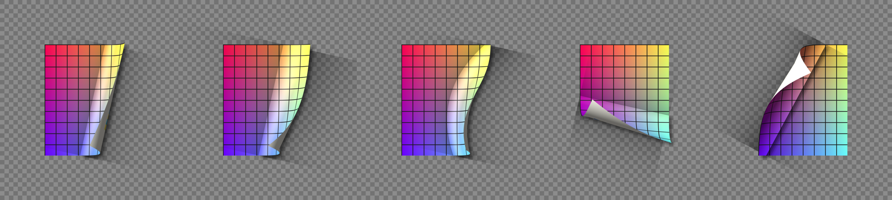

# Page Turn Pro (After Effects 이펙트)

CC Page Turn을 대신하는 페이지 넘김 이펙트입니다. C++ After Effects SDK로 만든 네이티브 이펙트이며, **Effect > Distort > Page Turn Pro**에 나타납니다.




위 이미지는 `test/render_core.cpp`로 렌더링 코어만 따로 돌린 결과입니다(AE 없이 확인용).

## CC Page Turn과 다른 점

| 그룹 | 파라미터 | 설명 |
|---|---|---|
| Turn | Progress | 0–100% 하나만 키프레임하면 넘김이 끝납니다. 경로는 자동으로 계산됩니다. |
| | Start Corner | 넘기기 시작할 모서리 |
| | Turn Direction | 옆으로(책) / 위아래(달력) |
| | Corner Tilt, Tilt Recovery | 모서리를 비스듬히 들어 올리고, 넘김이 끝날수록 똑바로 펴지는 정도 |
| | Ease, Overshoot | 내장 이징과 끝에서 살짝 넘어갔다 돌아오는 정도 |
| Curl | Radius, Mid-Turn Bulge | 기본 말림 반지름과 넘기는 중간에 커지는 정도 |
| | Cone | 시작 모서리에서 멀어질수록 말림이 넓어지는 정도(원뿔형). 0%면 CC Page Turn 같은 원통형 |
| | Fold Bend | 접힘선을 곡선으로 휘게 함 |
| Lighting | Light Direction, Light Height | 빛 방향과 높이(실제 곡면 노멀로 계산) |
| | Ambient, Specular, Shininess | 무광지 ↔ 광택지 표현 |
| Shadow | Color, Opacity, Direction, Distance, Softness | 넘어가는 종이가 아래 페이지에 드리우는 그림자. 종이 각 부분의 높이로 계산해서 접힌 선에서 시작하고 높이 들린 곳일수록 멀리 떨어짐. Distance는 넘어간 종이(가장 높은 부분)의 그림자가 떨어지는 거리. Light Direction을 바꾸면 Shadow Direction도 반대쪽으로 맞추세요 |
| | Contact Shadow | 말린 부분 밑의 어두움 |
| | Shadow On | 페이지에만(기본, 페이지 밖과 넘어가며 드러난 곳에는 그림자 없음) / 페이지와 아래 레이어 모두 |
| Back Page | Back Layer, Back Opacity, Paper Color | 뒷면 레이어와 종이 색 |
| | Back Mirror | 자동(넘김 방향에 맞게 뒤집어 바르게 읽힘) / 없음 / 가로 / 세로 |
| | Back Offset X/Y, Back Scale, Back Rotation | 뒷면 이미지 위치·크기·회전 |
| | Render | 전체 / 그림자 없이 / 넘어가는 부분만 / 그림자만 / 남은 앞면만 (합성용 패스) |
| | Quality | Draft / Normal(2x2 AA) / High(3x3 AA) |

레이어 밖으로 넘어간 페이지와 그림자가 잘리지 않도록 출력 버퍼를 자동으로 넓힙니다.

## 빌드 (macOS)

1. [Adobe After Effects SDK](https://developer.adobe.com/after-effects/)를 내려받아 압축을 풉니다(Adobe 계정 로그인 필요, 라이선스상 저장소에 넣지 않습니다).
2. Xcode 커맨드라인 도구와 CMake를 설치합니다.
   ```bash
   xcode-select --install
   brew install cmake
   ```
3. 빌드하고 설치합니다. 스크립트가 SDK 안의 `Examples/Headers`를 찾아 빌드한 뒤 `/Applications/Adobe After Effects 20xx/Plug-ins/PageTurnPro/`에 복사합니다.
   ```bash
   ./effect/build-mac.sh ~/Downloads/AfterEffectsSDK
   ```
4. After Effects를 다시 시작합니다.

## 구조

- `src/PageTurnCore.h`: 렌더링 코어. AE에 의존하지 않는 순수 C++입니다. 출력 픽셀마다 역으로 종이의 어느 지점이 보이는지 계산합니다(평평한 앞면, 원통 아랫면, 원통 윗면의 뒷면, 넘어간 뒷면 순으로 겹침).
- `src/PageTurnPro.cpp`: AE SDK 연결부. 파라미터, 출력 버퍼 확장(FRAME_SETUP), 8/16비트 픽셀 변환, 행 단위 병렬 렌더.
- `src/PageTurnProPiPL.r`: PiPL 리소스. 버전과 플래그는 `GlobalSetup`과 같아야 합니다.
- `test/render_core.cpp`: 코어만 렌더해 PPM으로 저장하는 확인용 프로그램.
  ```bash
  cmake -S effect -B build-test -DPTP_TEST_ONLY=ON && cmake --build build-test
  ./build-test/render_core /tmp/out
  ```

## 알려진 한계 (v0.1)

- 8/16비트만 지원합니다. 32비트(float)는 SmartFX로 옮길 때 추가 예정입니다.
- CPU 렌더링입니다(GPU 미지원).
- macOS 빌드만 구성되어 있습니다.
- 그림자 방향은 Light Direction과 따로 정합니다(자동으로 연동되지 않음).
